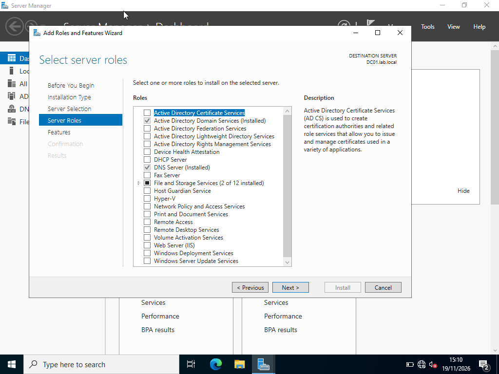
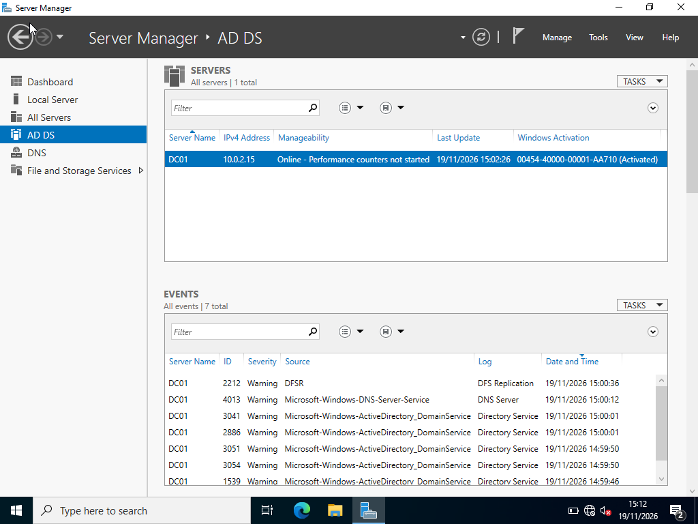
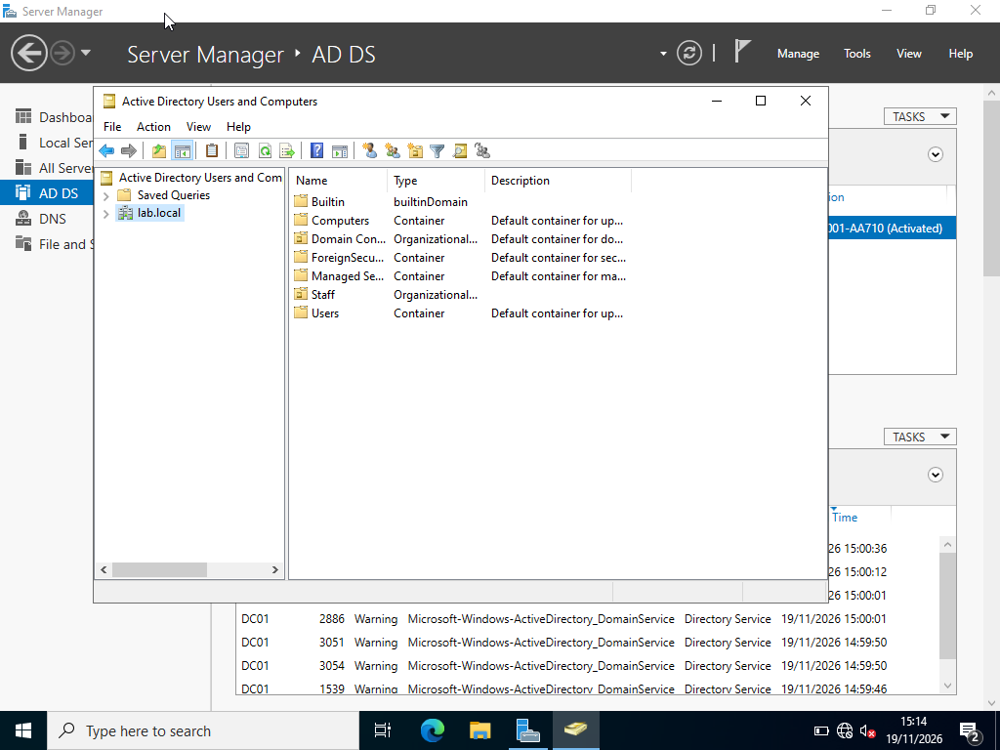
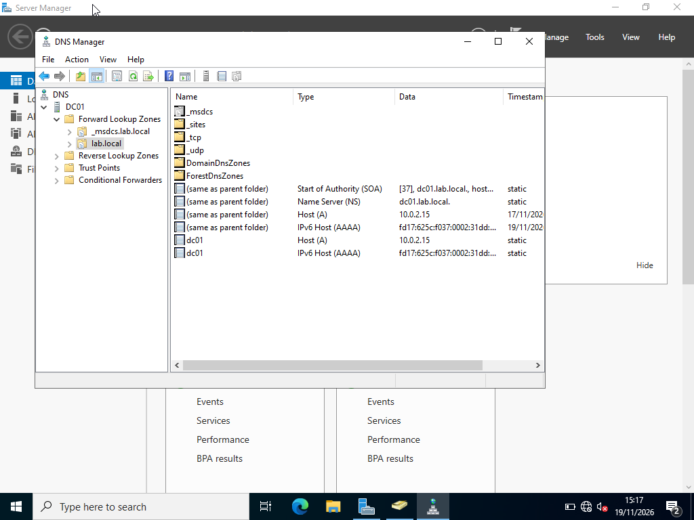

# Task 02 – Active Directory and Domain Configuration

## Scenario
An organisation needs a centralised way to manage its computers, user accounts and access to network resources.

## Objective
Install Active Directory Domain Services (AD DS) and configure Windows Server as a Domain Controller for a new domain.

## Tools Required
- Windows Server 2022
- Server Manager
- Active Directory Domain Services (AD DS)
- DNS Server
- Active Directory Users and Computers (ADUC)

## Investigation
- Review the available server roles and features.
- Identify the requirements for setting up a new Active Directory domain.
- Understand the purpose of a Domain Controller and DNS within a domain environment.

## Implementation
- Install the Active Directory Domain Services role through Server Manager.
- Promote `DC01` to a Domain Controller.
- Create a new forest using the domain name `lab.local`.
- Enable DNS Server and Global Catalog.
- Set the domain and forest functional levels to Windows Server 2016.
- Complete the configuration and restart the server.

## Verification
- Confirm that the server restarts successfully.
- Open Active Directory Users and Computers.
- Check that the `lab.local` domain has been created.
- Confirm that the default Active Directory folders are present.

## Evidence

### Active Directory and DNS Roles

### Domain Controller Overview

### Active Directory Domain Structure

### DNS Forward Lookup Zone

## Key Learnings
- Understanding Active Directory and its purpose in an organisation.
- Learning how to install AD DS and promote a server to a Domain Controller.
- Understanding domains, forests, DNS and Global Catalog.
- Learning how centralised user and computer management works.
