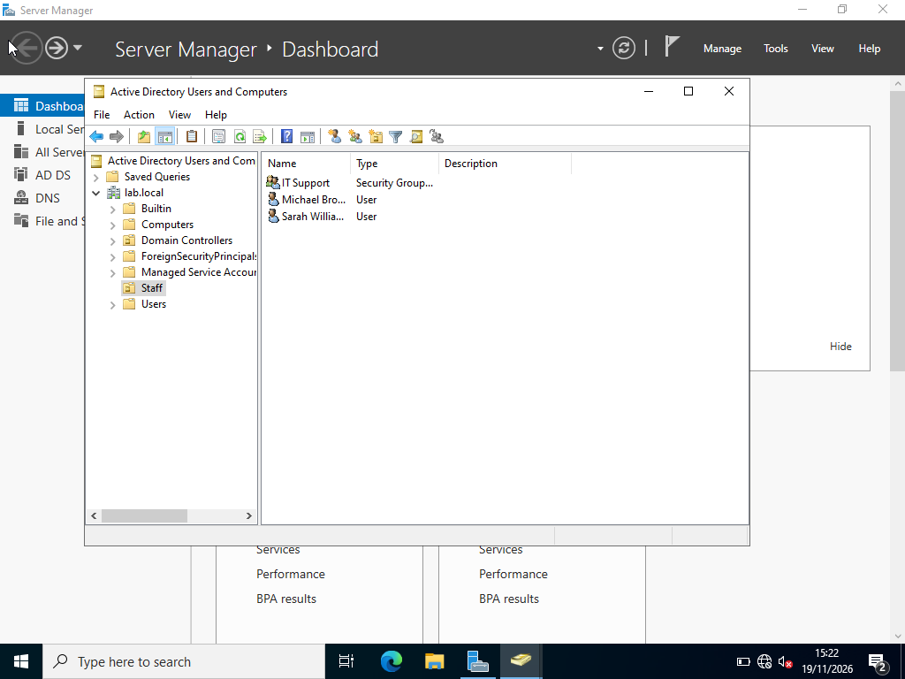
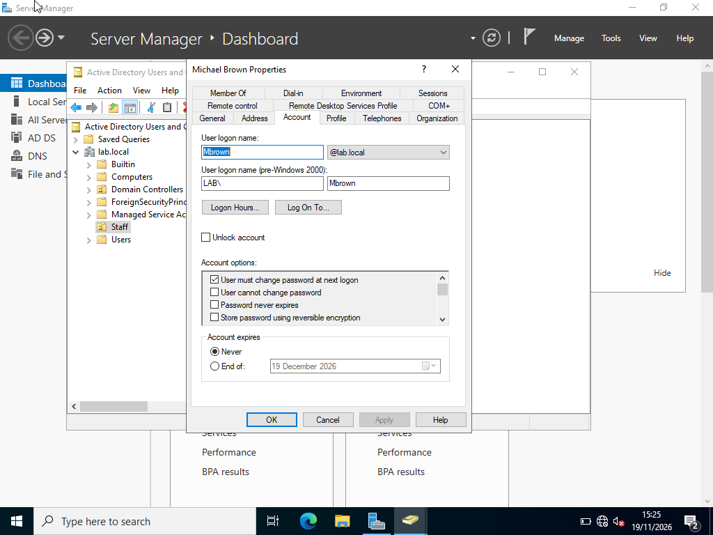
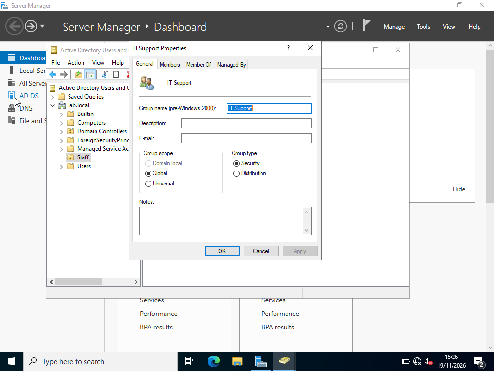
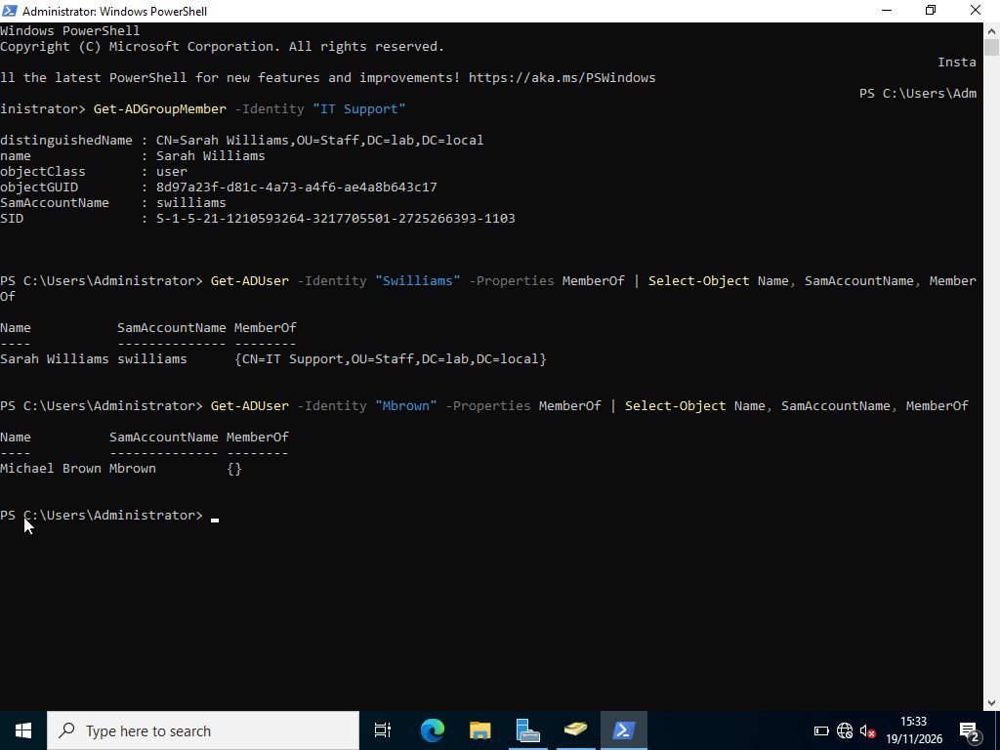

# Task 03 – User, OU and Security Group Management

## Scenario
An organisation needs to create and organise employee accounts while controlling access to resources based on their job responsibilities.

## Objective
Create an Organisational Unit (OU), set up user accounts and create a security group to manage user membership and access.

## Tools Required
- Windows Server 2022
- Active Directory Users and Computers (ADUC)
- Windows PowerShell
- Active Directory PowerShell module

## Investigation
- Explore the existing structure within the `lab.local` domain.
- Review the default containers and folders in Active Directory.
- Understand how OUs, user accounts and security groups are used to organise and manage access.

## Implementation
- Create an OU named `Staff` within the `lab.local` domain.
- Create two fictional employee accounts:
  - Sarah Williams (`swilliams`)
  - Michael Brown (`mbrown`)
- Set temporary passwords and require users to change them at their next logon.
- Create a security group named `IT Support`.
- Configure the group with Global scope and Security group type.
- Add Sarah Williams to the `IT Support` group, leaving Michael Brown outside the group.

## Verification
- Confirm that the `Staff` OU contains both user accounts.
- Check that the `IT Support` group has been created.
- Use PowerShell to check the group's membership.
- Confirm that Sarah Williams is a member and Michael Brown is not.

## Evidence

### Staff Organisational Unit and User Accounts

### Sarah Williams – User Account

### Michael Brown – User Account

### IT Support – Security Group Configuration

### PowerShell – Group Membership Verification

## Key Learnings
- Understanding how OUs organise users and other Active Directory objects.
- Creating and managing domain user accounts.
- Understanding the difference between user accounts and security groups.
- Learning how group membership can be used to manage access.
- Using PowerShell to check and verify Active Directory information.
