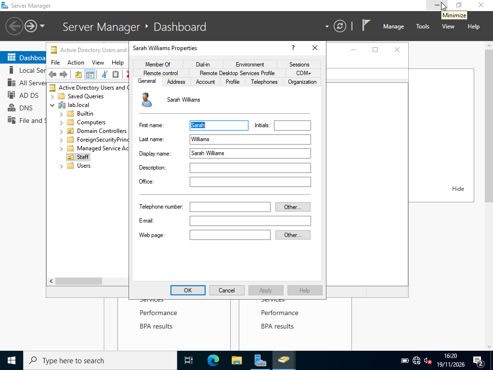
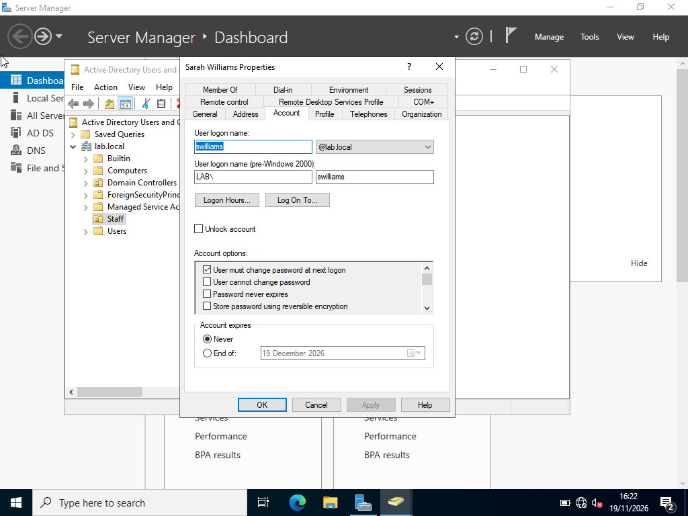
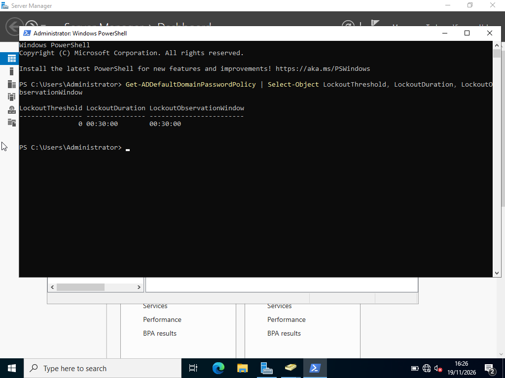
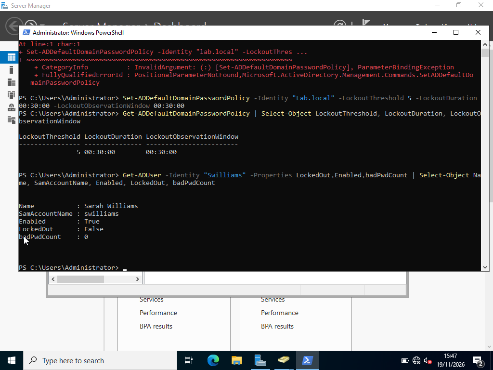
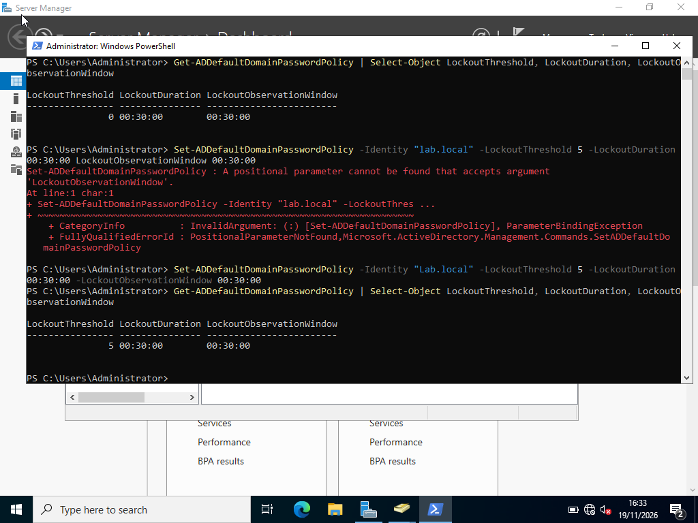
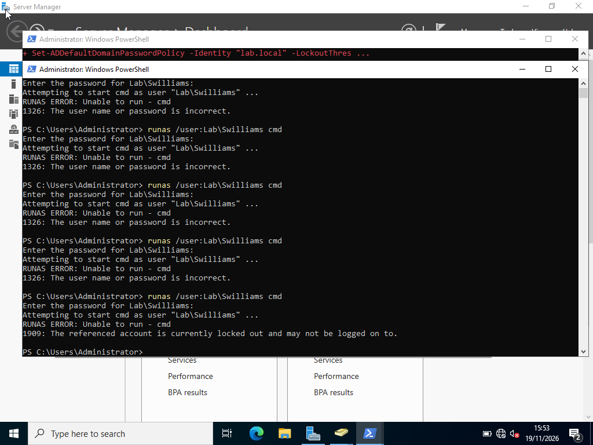
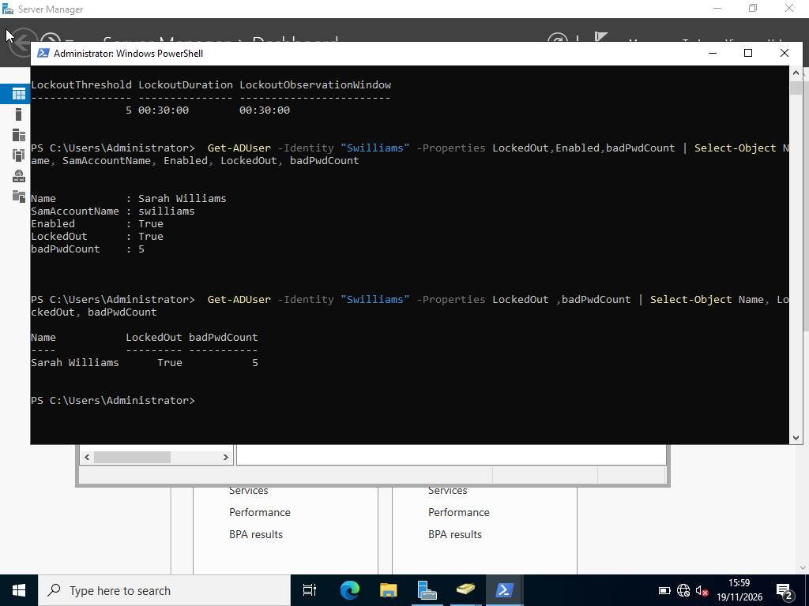
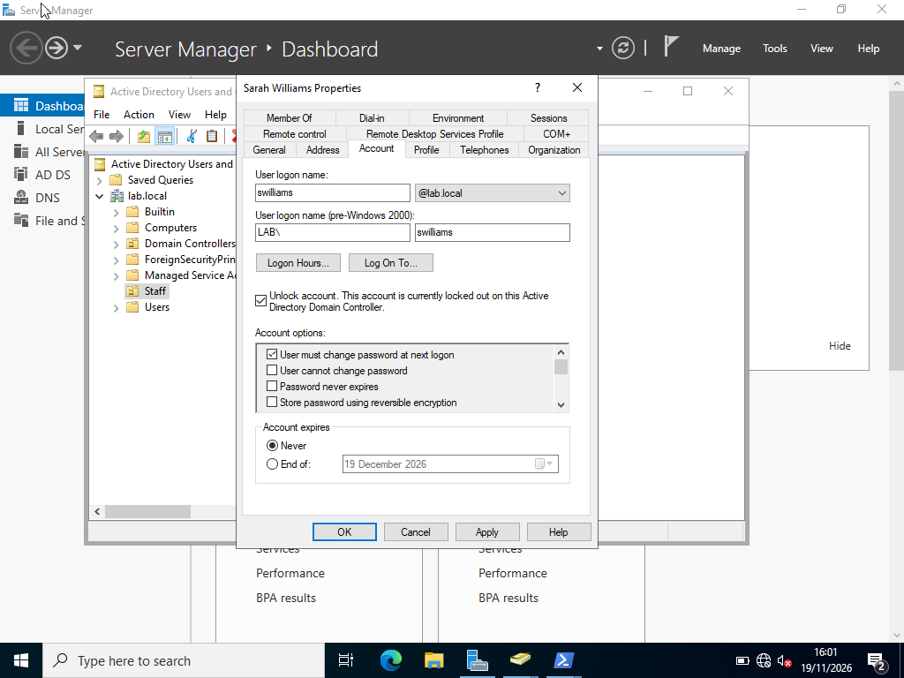
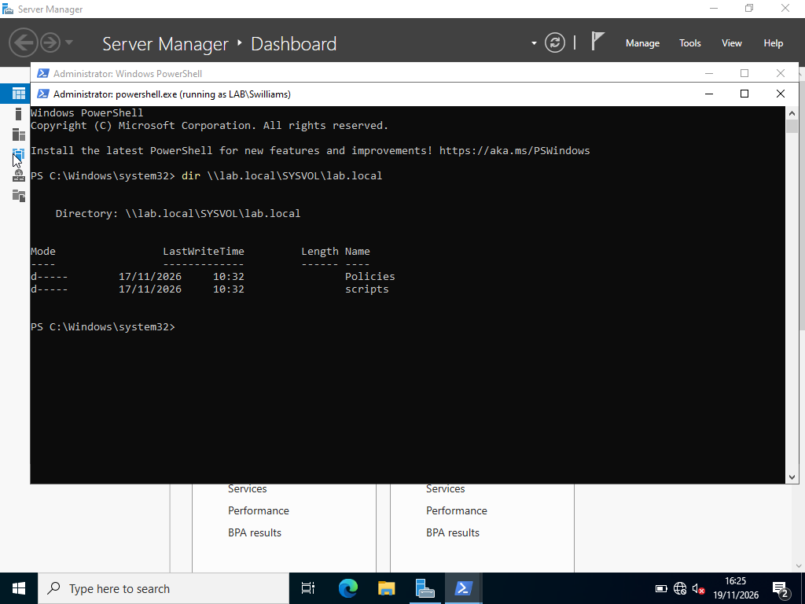
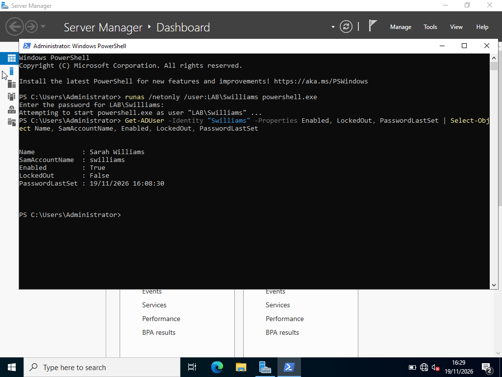

# Task 04 – User Unable to Log Into Account (Account Locked)

## Scenario

A Finance employee, Sarah Williams, is unable to log into her Windows account. She receives the following error message:

"The referenced account is currently locked out and may not be logged on to."

The issue needs to be investigated to find out why the account was locked and restore her access.

## Objective

- Check Sarah's account in Active Directory.
- Review the domain's account lockout settings.
- Test the account lockout policy.
- Unlock Sarah's account.
- Check that her new password works for network authentication.

## Tools Required

- Windows Server 2022
- Active Directory Users and Computers (ADUC)
- Windows PowerShell
- Active Directory PowerShell module
- Jira Service Management

## Investigation

### 1. Check Sarah's Account

Opened Active Directory Users and Computers and located Sarah Williams' account in the `Staff` organisational unit.

Checked her account properties and found that the account was enabled but was not currently locked.





### 2. Check the Account Lockout Policy

Used PowerShell to check the domain's existing password policy:

```powershell
Get-ADDefaultDomainPasswordPolicy | Select-Object LockoutThreshold, LockoutDuration, LockoutObservationWindow
```

The results showed that the lockout threshold was set to `0`, meaning account lockout was disabled. The lockout duration and observation window were both set to 30 minutes.



### 3. Check Sarah's Account Status

Ran the following command to check whether the account was enabled, locked or had any failed password attempts:

```powershell
Get-ADUser -Identity "swilliams" -Properties LockedOut,Enabled,badPwdCount |
Select-Object Name,SamAccountName,Enabled,LockedOut,badPwdCount
```

The results confirmed that the account was enabled, was not locked and had a failed password count of zero.



## Implementation

### 4. Update the Account Lockout Policy

Updated the domain policy so that an account would be locked after five incorrect password attempts. The lockout duration and observation window were both set to 30 minutes.

Used the following command:

```powershell
Set-ADDefaultDomainPasswordPolicy -Identity "lab.local" -LockoutThreshold 5 -LockoutDuration 00:30:00 -LockoutObservationWindow 00:30:00
```

The first attempt returned an error because a hyphen was missing from one of the parameters. After checking the error message, corrected the command and ran it again successfully.

Checked the policy afterwards to confirm that the new settings had been applied.



### 5. Test the Lockout Policy

Used repeated incorrect login attempts with Sarah's account to test the new policy.

After five failed attempts, the account was locked as expected.



Checked the account again using PowerShell and confirmed that `LockedOut` was `True` and the failed password count was five.



### 6. Unlock Sarah's Account

Opened Sarah's account properties in Active Directory Users and Computers and selected the option to unlock the account.

Applied the change and checked the account again using PowerShell.



The account was no longer locked, and the failed password count had reset to zero.


### 7. Test Sarah's New Password

Used Sarah's temporary password to complete the required password change.

An attempt to log into the Domain Controller directly was blocked with the message:

"The sign-in method you're trying to use isn't allowed."

This was due to the Domain Controller's logon restrictions, rather than an incorrect password. I left these security settings unchanged and used a network authentication test instead.


Ran the following command to open a separate PowerShell session using Sarah's credentials:

```powershell
runas /netonly /user:LAB\swilliams powershell.exe
```

After entering the new password, tested access to the domain's SYSVOL network share:

```powershell
dir \\lab.local\SYSVOL\lab.local
```

The command successfully displayed the contents of the share, including the `Policies` and `scripts` folders.



## Verification

Ran a final PowerShell check to confirm that Sarah's account was enabled, unlocked and had an updated password:

```powershell
Get-ADUser -Identity "swilliams" -Properties Enabled,LockedOut,PasswordLastSet |
Select-Object Name,SamAccountName,Enabled,LockedOut,PasswordLastSet
```

The results confirmed that:

- The account was enabled.
- The account was no longer locked.
- The password had been updated.



The successful SYSVOL access test also confirmed that Sarah's new credentials could authenticate to a domain network resource. Direct Windows desktop sign-in was not verified because of the Domain Controller's logon restrictions.

The investigation and resolution were recorded in Jira Service Management. The ticket was marked as Resolved and Done.


## Evidence

Screenshots showing the account investigation, policy changes, lockout test, account unlock, authentication test and Jira resolution have been included throughout this README.

## Key Learnings

- How to check user accounts and account lockout settings in Active Directory.
- How to update domain password policies using PowerShell.
- How to test account lockout by simulating failed login attempts.
- How to unlock an account and check that the failed password count has reset.
- How to test network authentication using a domain account.
- Why Domain Controllers have additional logon restrictions.
- The importance of recording investigation steps and resolutions in a helpdesk ticket.
