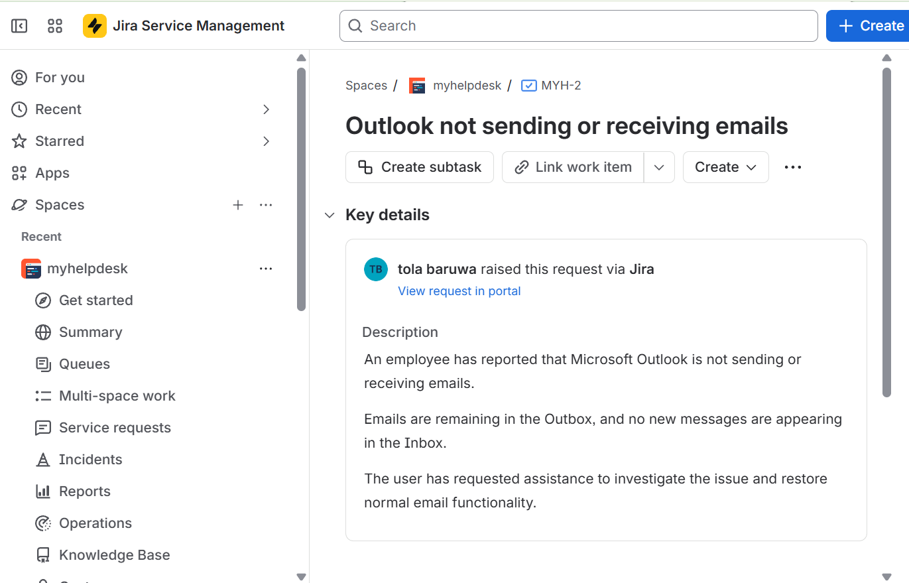
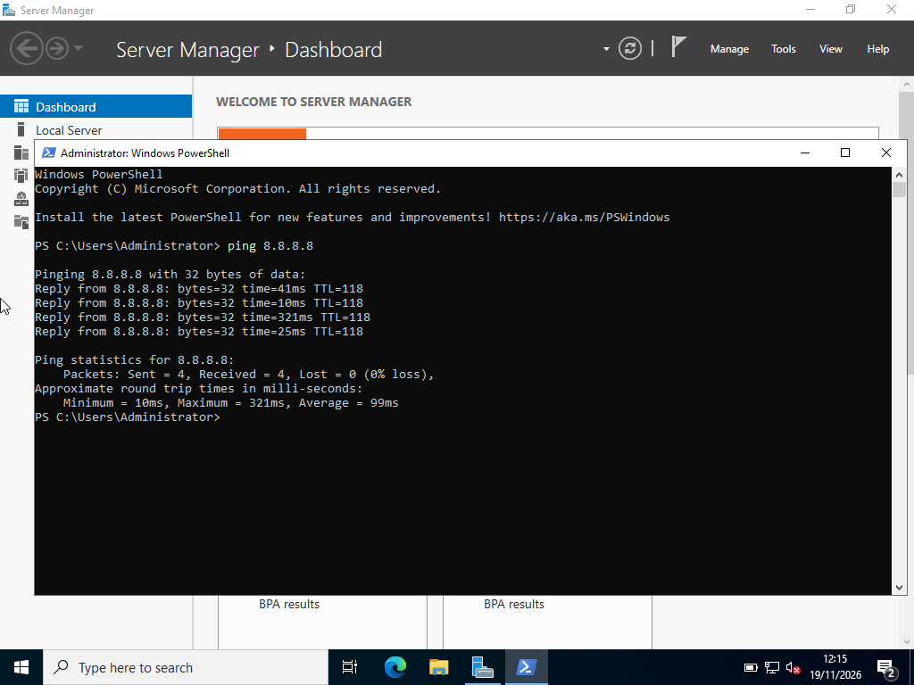
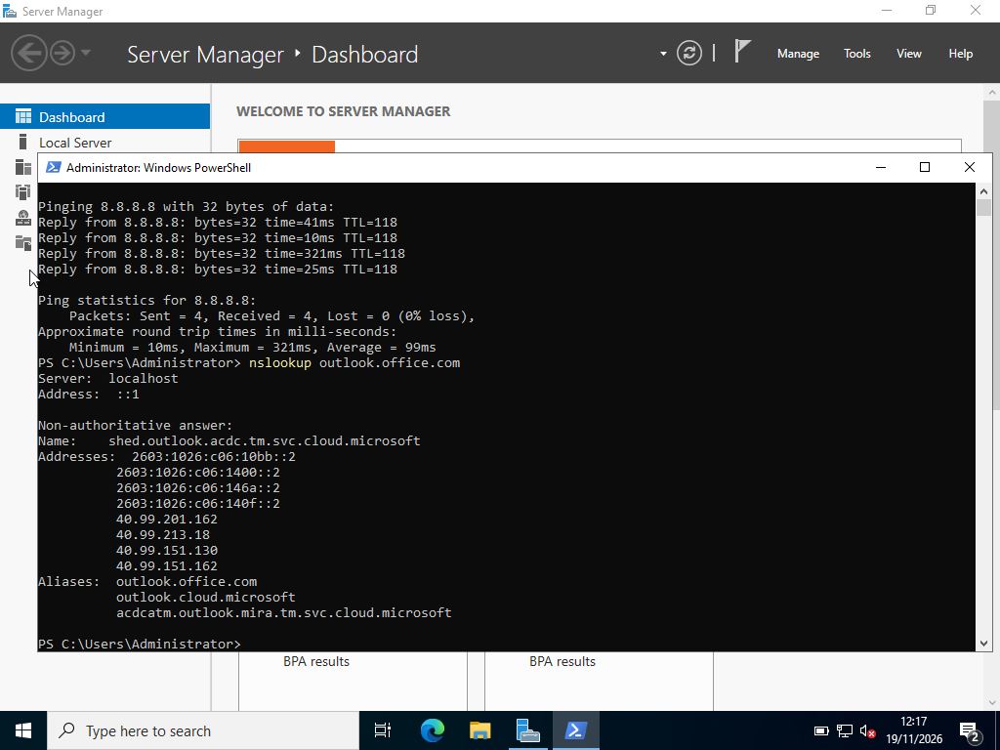
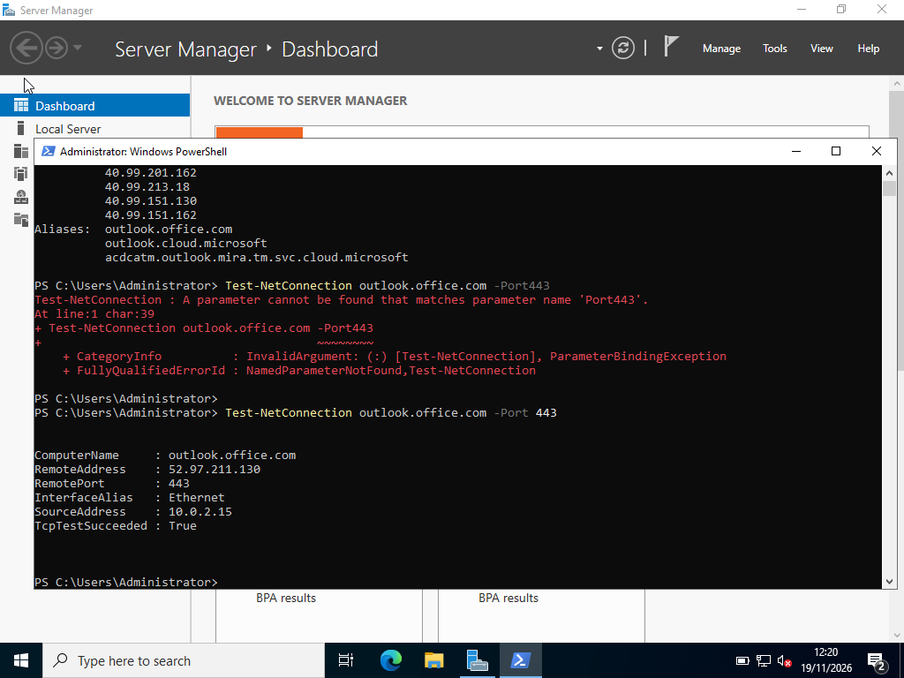
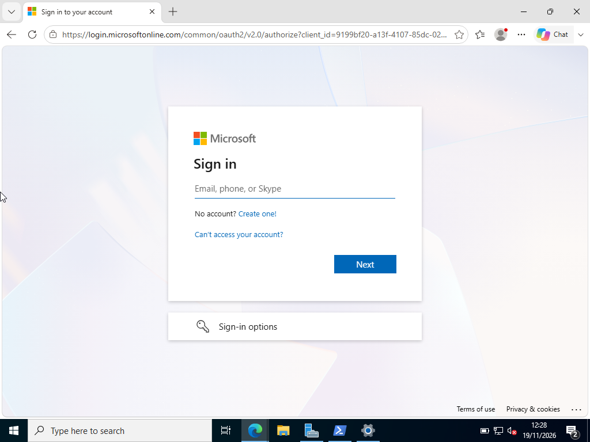
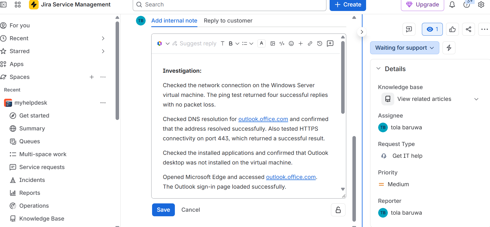

# Task 05 – Outlook Not Sending or Receiving Emails

## Scenario

An employee reports that Outlook is not sending or receiving emails. Messages appear to remain in the Outbox, and no new messages are arriving in the Inbox.

## Objective

Investigate the issue by checking internet connectivity, DNS resolution and access to Outlook Web. Identify whether the problem could be related to network connectivity or the availability of Outlook.

## Tools Required

- Windows Server 2022 virtual machine (DC01)
- PowerShell
- Command Prompt
- Microsoft Edge
- Jira Service Management

## Investigation

I started by checking whether the virtual machine had an active internet connection.

I ran:

```powershell
ping 8.8.8.8
```

The test returned four successful replies with no packet loss, confirming that the machine could reach the internet.

I then checked whether the Outlook service address could be resolved:

```powershell
nslookup outlook.office.com
```

The command returned a name and associated addresses, confirming that DNS resolution was working.

Next, I tested HTTPS connectivity to Outlook using:

```powershell
Test-NetConnection outlook.office.com -Port 443
```

The result showed `TcpTestSucceeded: True`, confirming that a connection to the service on port 443 was successful.

## Implementation

I checked the installed applications and attempted to launch Outlook using `outlook.exe`. Windows could not find the application.

I then checked the installed apps list and confirmed that Outlook desktop was not installed on the virtual machine.

As a final check, I opened Microsoft Edge and visited `https://outlook.office.com`. The Outlook sign-in page loaded successfully.

No Microsoft 365 mailbox was configured in the lab, so I did not sign in or attempt to send and receive emails.

## Verification

The investigation confirmed that:

- Internet connectivity was working.
- DNS resolution for `outlook.office.com` was successful.
- HTTPS connectivity on port 443 was successful.
- Outlook desktop was not installed.
- The Outlook Web sign-in page was accessible.

However, the original email sending and receiving problem could not be fully tested. A configured Microsoft 365 mailbox would be needed to investigate the mailbox itself.

The Jira ticket was updated with the investigation findings. It was not marked as resolved because the reported email issue had not been confirmed as fixed.

## Evidence

**Jira ticket created**



**Internet connectivity test**



**DNS resolution test**



**HTTPS connectivity test**



**Outlook Web sign-in page**



**Jira investigation notes**



## Key Learnings

- Basic network checks are useful when investigating email connectivity problems.
- DNS resolution and HTTPS connectivity can be tested using PowerShell and Command Prompt.
- A successful connection to Outlook does not automatically mean that a user's mailbox is working.
- It is important to check whether the required application is installed before attempting to troubleshoot it.
- Investigation notes in Jira help keep a clear record of the checks performed and the findings.
- A ticket should not be marked as resolved unless the reported issue has actually been fixed or verified.
